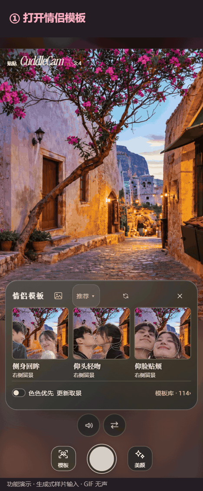
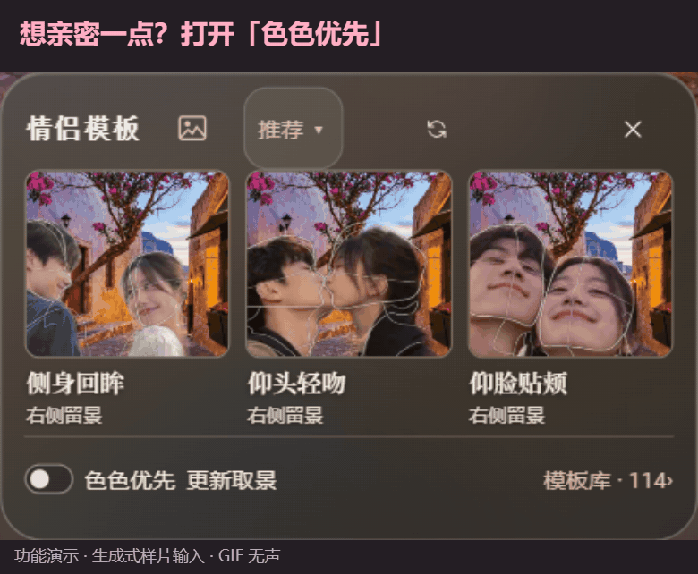
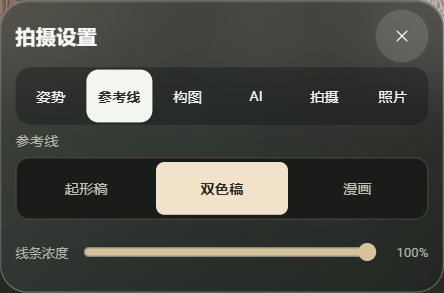
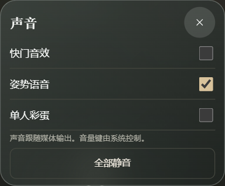
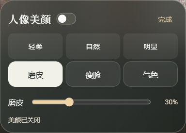

# 贴贴相机 · CuddleCam

**你们负责贴贴，姿势我来教。**

**[⬇ 下载 Android APK · v2.3.2-beta.1](https://github.com/zhangyiran0000-wq/cuddlecam/releases/download/v2.3.2-beta.1/CuddleCam-2.3.2-beta.1.apk)**　[版本说明与校验文件](https://github.com/zhangyiran0000-wq/cuddlecam/releases/tag/v2.3.2-beta.1)

Android 10+ · 约 242 MB（含离线模型）· **Beta 测试版**。下载 `.apk` → 安装 → 允许相机权限。

  
  
  

114 款情侣姿势 · 双人参考线 · 中文语音指导 · 离线可用

## 三步拍出情侣照

**① 挑姿势 → ② 跟着摆、点快门 → ③ 保存相册**

  
  

模板库可搜索动作、按分类翻页；按提示靠近，点快门或「3 秒」拍照。

## 想再亲密一点？

**「色色优先」** 默认关闭。开启后，亲吻、贴脸等亲密动作优先推荐；随时可关。

## 选项

  
  
  

- **单手操作：** 短面板、按钮翻页；快门随旋转放到前摄对侧。镜头位置不准时，点双向箭头校准。
- **声音：** 音量键照常调系统音量。语音和彩蛋可在声音面板关闭。
- **识别不到？** 侧脸、亲吻遮挡和弱光仍可能漏检，直接按快门或用三秒倒计时。

图片为内置生成式参考照；GIF 是实际界面配样片输入的功能演示，无音轨，不代表真机识别表现。当前版本仍需实体手机实测。

---

[开发、构建与测试](docs/TECHNICAL_NOTES.md#开发与构建) · [详细功能与版本记录](docs/TECHNICAL_NOTES.md) · [AI 模型说明](web/vendor/coach/NOTICE.txt) · [后期模型许可证](web/vendor/style/NOTICE.txt)
